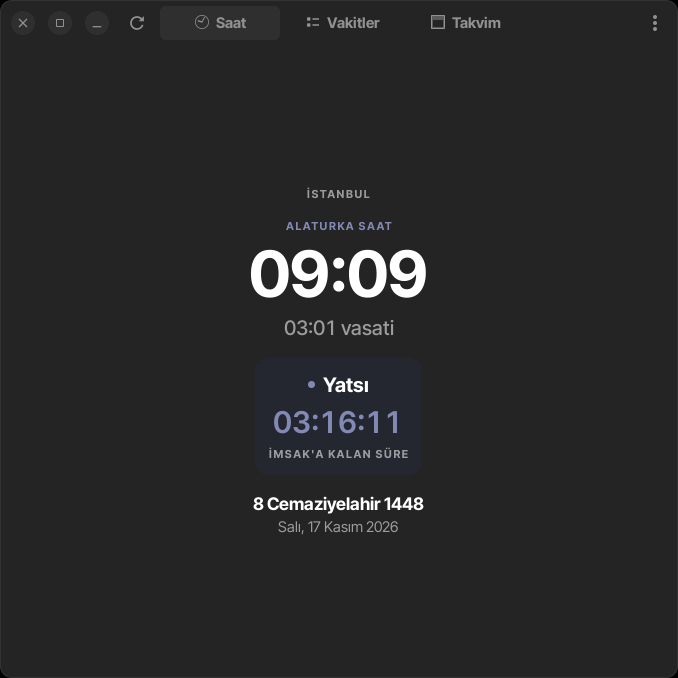
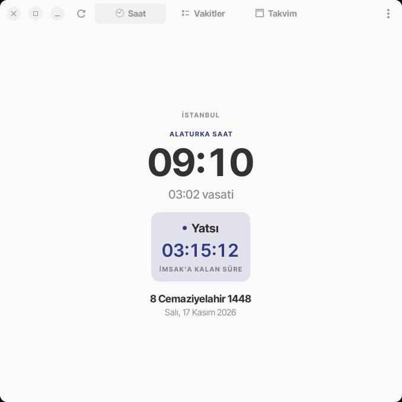
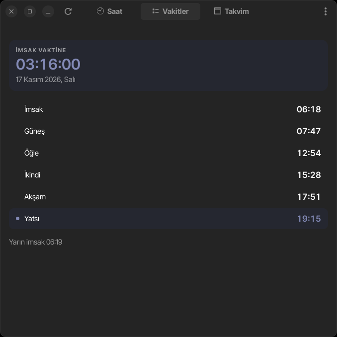
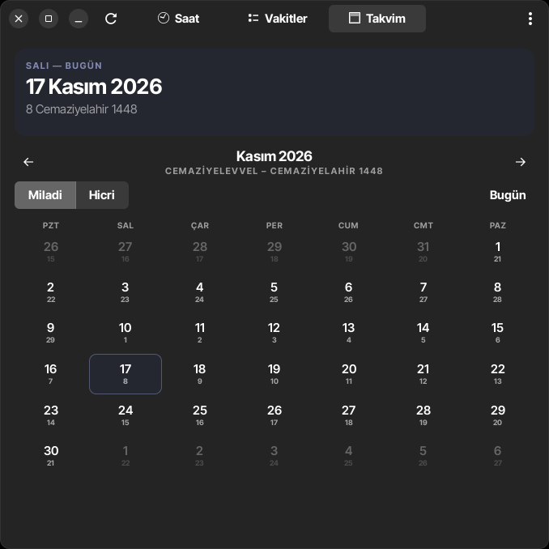
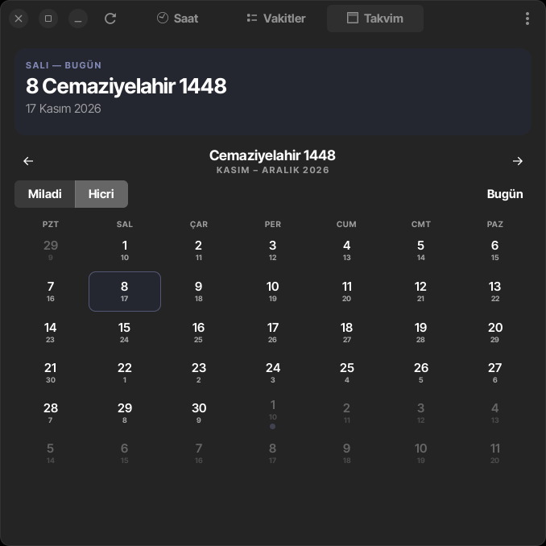
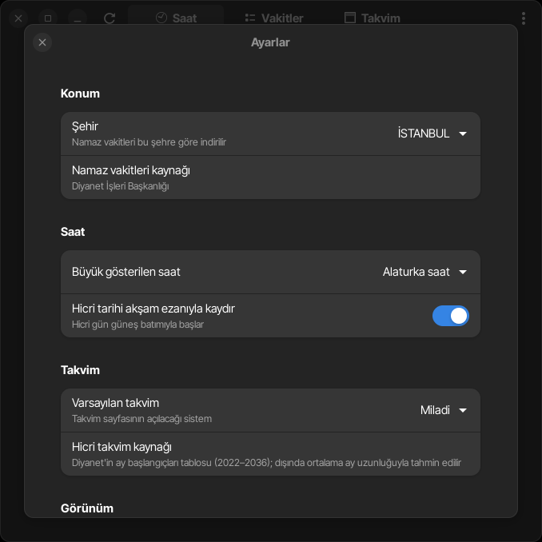

# alaturka-desktop

Native Linux desktop app for Alaturka Vakitler — the alaturka clock, Diyanet
prayer times, the hijri calendar and the religious days.

<p align="center">
  
  
</p>

<p align="center">
  
  
  
</p>

The alaturka clock counts from the evening adhan rather than from midnight.
Everything else on screen follows from that: the hijri date rolls over at
sunset too, and so do the religious days, because they are hijri rules.

Flatpak app ID: `com.alaturkavakitler.Vakitler`

---

## Installing

### Debian, Ubuntu, Linux Mint

Download the `.deb` from [Releases][releases] and install it:

```sh
sudo apt install ./alaturka-vakitler_0.1.0_all.deb
```

The package is 65 kB. It declares `gjs`, GTK 4, libadwaita and libsoup3 as
dependencies rather than bundling them — all four are in Ubuntu 22.04+ and
Mint 21+, and apt will pull in anything missing.

### Any other distribution — Flatpak

```sh
flatpak install --user alaturka-vakitler.flatpak
flatpak run com.alaturkavakitler.Vakitler
```

Worth taking if your distribution's libadwaita is older than 1.4: the
Flatpak brings its own from the GNOME runtime.

### From source

```sh
git clone --recurse-submodules https://github.com/saatleriayarlamaenstitusu/alaturka-desktop
cd alaturka-desktop
meson setup _build --prefix=/usr
sudo meson install -C _build
```

`--recurse-submodules` is not optional: the shared rules live in
[`alaturka-core`][core] and the build stops if `core/` is empty. On a system
that ships Cinnamon's `cjs` but not `gjs`, add `-Dgjs=cjs`.

[releases]: https://github.com/saatleriayarlamaenstitusu/alaturka-desktop/releases
[core]: https://github.com/saatleriayarlamaenstitusu/alaturka-core

---

## Running it from a checkout

```sh
./bin/alaturka-vakitler
```

No install step. The launcher compiles the GSettings schema into `data/` and
builds a throwaway XDG data directory under `_build/share` holding the
`.desktop` file and the icon theme, then prepends it to `XDG_DATA_DIRS`.
Both are needed before the app starts: `new Gio.Settings()` aborts the
process rather than throwing when its schema is missing, and notifications
are dropped silently when no desktop file matches the application ID.

It prefers `gjs` and falls back to `cjs` — Cinnamon's fork, already on Mint —
because it runs the same code, and that is where this is being tested.

---

## Stack

- **GTK4 + libadwaita.** A GNOME-native look means libadwaita, and
  libadwaita is GTK4-only.
- **GJS.** The shared core is JavaScript, so GJS imports it as-is and no
  translation layer appears. Verified, not assumed: the core runs in a GJS
  runtime unchanged — no shim, no bundler, no JSON import attributes.
  Measured against GTK 4.14 and libadwaita 1.5.
- **`alaturka-core` as a submodule.** The hijri table, the religious-day
  rules, the alaturka arithmetic and the prayer-time table are shared with
  the website; none of it is reimplemented here.

```
bin/alaturka-vakitler   dev launcher (schema + XDG dir + runtime)
build-aux/              .deb script, Flatpak manifest
core/                   alaturka-core (submodule)
data/                   GSettings schema, stylesheet, desktop entry,
                        AppStream metadata, icons
src/main.js             Adw.Application, actions, stylesheet
src/lib/vakitler.js     fetch + merge-cache
src/lib/store.js        the one ticking clock everything subscribes to
src/lib/theme.js        prayer-time colour -> GTK stylesheet
src/lib/text.js         Turkish uppercasing
src/lib/notify.js       prayer-time reminders (before the adhan)
src/ui/window.js        header, view switcher, breakpoint
src/ui/pages/           clock, times, calendar
src/ui/prefs.js         preferences dialog
```

---

## Data

Prayer times come from the same source as the website: raw JSON from the
`data-diyanet-namaz-vakitleri` repository, fetched with libsoup3 and cached
under `~/.cache`. Settings live in GSettings.

The published file is a **rolling 36-day window** (nine days behind, today,
twenty-six ahead), not a year — measured. So the cache merges rather than
replaces: the alaturka clock counts from the PREVIOUS evening's maghrib, and
a plain overwrite would drop the days it still needs if the app sat idle
across a window roll. Merging is also what makes the app work offline for as
long as the last download reaches.

`Gio._promisify` is called explicitly on the libsoup calls. Newer GJS wraps
`*_async` methods by itself, older runtimes do not (`At least 4 arguments
required, but only 3 passed`), and asking twice is harmless.

---

## Tray icon

`libayatana-appindicator3` links against GTK3 and cannot share a process
with GTK4:

```
ImportError: Requiring namespace 'Gtk' version '3.0', but '4.0' is already loaded
```

So using the ready-made indicator library would mean giving up libadwaita.
Instead the icon will be published **directly over D-Bus**. Two interfaces,
one code path:

- **`org.x.StatusIcon`** (XApp) — Mint and Cinnamon. This interface carries
  a `Label` property, and `xapp-status@cinnamon.org` renders it in the panel
  as an `St.Label` (see its `applet.js:129,157`). That means the tray icon
  itself can show live text on Mint: a ticking alaturka clock and the
  countdown to the next prayer, with no applet involved.
- **`org.kde.StatusNotifierItem`** — GNOME, KDE, XFCE, Budgie. Icon,
  tooltip and menu only; the protocol has no panel text.

All three watchers are present on a stock Mint 22 session bus:
`org.kde.StatusNotifierWatcher`, `org.x.StatusNotifierWatcher`,
`org.x.StatusIcon.xapp_sn_watcher`.

**Caveat on GNOME:** GNOME Shell has no built-in tray, so the icon only
appears if the user has the AppIndicator extension installed. The app will
say so once rather than failing silently.

---

## Notes worth keeping

- **One timer.** The store ticks once a second and emits; no page owns a
  timer, so no two parts of the window can disagree about the time. The
  prayer-time table is rebuilt when the day turns, not every second.
- **That table has to be dropped when the DATA changes too, not only when
  the day does.** Changing the city brings a whole new set of times for the
  same day; the page kept counting down to the old city's next prayer
  because the rebuild check only looked at the date. Every assignment to
  the prayer-time data goes through `Store._setDays`, which clears the
  table with it, so a call site cannot forget.
- **Both calendars are drawn by the same code.** A month is reduced to three
  answers — which date its first cell holds, how long it runs, and whether a
  date belongs to it — and the grid, the navigation and the two numbers in
  each cell read those. A second branch for the hijri grid would have meant
  two places to fix every time a cell changed.
- **The prayer-time colours are not interface accents.** They were picked as
  colours of a time of day: yatsı is `#2e3b83`, which sits at 1.7:1 against
  libadwaita's dark background and cannot be read as text. `src/lib/theme.js`
  mixes the accent toward white or black until it clears 4.5:1 and keeps the
  untouched colour for washes and fills. The website solved the same problem
  by hand with a separate `--accent-ui`.
- **No `text-transform: uppercase` anywhere.** GTK's CSS maps `i` to `I`, not
  to `İ`; "İmsak vaktine" came out as "İMSAK VAKTINE". The labels are
  uppercased in JavaScript, which knows the rule (`src/lib/text.js`).
- **`wrap: true` with `halign: START` is a trap.** A wrapping label then
  asks for its MINIMUM width — the longest single word — and breaks inside
  that; "KAYNAK: DİYANET" split after the colon in a card three times wider.
  Use `halign: FILL` with `xalign`.
- **GTK 4.14 has no CSS custom properties** (those arrive in 4.16), so the
  accent cannot be a variable the stylesheet reads. The rules that mention
  it are regenerated and reloaded on each change.
- **Keep `<svg` inside GdkPixbuf's sniffing window.** The app icon would
  not render in the Cinnamon menu — blank slot, every other entry fine —
  and `Gtk.IconTheme` was resolving it correctly the whole time. GdkPixbuf
  decides a file's format from its opening bytes, and the explanatory
  comment at the top of the icon had pushed `<svg` to byte 330; the loader
  answered `Couldn't recognize the image file format` while Inkscape and
  every browser rendered the file perfectly. The comment now lives inside
  the root element and `<svg` sits at byte 39.

  Two wrong turns on the way, both worth remembering. The failure looks
  like a missing SVG loader, so the first conclusion was that only the
  i386 build of `librsvg2-common` was installed — it was not, the amd64
  loader was there and `nemo.svg` loaded at the same size from the same
  process, which is the check that settled it. The second was to blame the
  icon sizes: GTK falls back to `scalable/` for any size with no exact
  raster, and the Cinnamon menu asks for **28px**, so adding rasters moved
  the symptom around (16, 22, 24, 32 worked; 18, 19, 26, 28, 36, 40 did
  not) without touching the cause. Ask the loader directly instead of
  reasoning about it:

  ```python
  GdkPixbuf.Pixbuf.new_from_file_at_size(path, 28, 28)
  ```

- **Ship every standard icon size anyway.** 16, 22, 24, 32, 48, 64, 96,
  128, 256, 512 — an exact raster is cheaper than rasterising the SVG, and
  it is what keeps the icon working if the scalable one ever cannot be
  read.
- **The narrow breakpoint is 560px, not 480px.** The header also holds the
  window controls and the menu, and on a layout with controls on both sides
  the switcher labels started ellipsizing ("Vakit…") at around 500px.

---

## Releases and CI

Two packages, built by `.github/workflows/release.yml` on a `v*` tag and
attached to the Release:

| | For | Size | Built by |
|---|---|---|---|
| `.deb` | Debian, Ubuntu, Mint | ~65 kB | `build-aux/build-deb.sh` over the Meson install tree |
| `.flatpak` | everyone else | runtime-sized | `build-aux/com.alaturkavakitler.Vakitler.yml` |

**No AppImage.** A GJS/GTK4 app has no binary of its own — it is scripts
plus data, and everything it needs is a system library. The `.deb` declares
those and weighs 65 kB; the Flatpak gets them from the GNOME runtime. An
AppImage would have to carry a GTK stack and a JS interpreter inside it to
reach what the other two get for free, and it would still miss the portal
integration the Flatpak has.

**Is CI necessary?** For releases, yes — building the Flatpak needs the
GNOME SDK, which is a two-gigabyte download nobody wants on their laptop for
a tag. `.github/workflows/check.yml` also runs on every push: it installs
into a staging prefix, validates the desktop entry, the AppStream metadata
and the schema, then **starts the app under Xvfb and quits it**, failing on
any `JS ERROR`. There are no unit tests here on purpose — the rules that
could be wrong (hijri conversion, religious days, the alaturka clock) live
in `alaturka-core` and are tested there against a golden reference. What
this repository can get wrong is the shell, so that is what is checked.

Flathub is the obvious next step once the app has a stable release; the
AppStream file (`data/*.metainfo.xml`) is already written for it.

### A note on repository visibility

`alaturka-core` is public, and it has to stay that way for CI: it is a
submodule of this repository, and `actions/checkout` authenticates with the
automatic `GITHUB_TOKEN`, which is scoped to **this** repository only. While
both were private the submodule clone failed with

```
remote: Repository not found.
```

which is misleading — the repository existed; GitHub answers 404 rather than
403 for a private repository the caller cannot see. Making the core public
is the right fix rather than a workaround: it is a shared library meant to
be used by the website, this app and a future mobile one, and Flathub builds
from public sources. If it ever goes private again, the checkout steps need
a PAT with read access to it.

Building a `.deb` locally:

```sh
./build-aux/build-deb.sh          # -> _build/deb/alaturka-vakitler_<version>_all.deb
```

---

## Scope

**Phase 1** — prayer times with countdown, alaturka clock, hijri calendar
and religious days, city selection, settings, and prayer-time reminders.
Notifications are the main thing the web app cannot do properly: the
browser can only remind you while its tab is open.

**Phase 2** — the share-image creator.

## Status

The window works: three pages (clock, prayer times, calendar), a
preferences dialog, live data with an offline cache, prayer-time theming,
notifications and the app icon. Verified on screen in both colour schemes
and at both breakpoints, and from a staged install prefix as well as a
checkout.

Not done yet:

- **The tray icon.** Both D-Bus faces described above are still unwritten;
  this is the next piece.
- The Flatpak build is exercised in CI only — the manifest parses locally
  (`flatpak-builder --show-manifest`), but the GNOME SDK is not installed
  on the development machine.
- Only exercised under `cjs` so far. `gjs` is not installed here.

### A bug this app found in the core

Between midnight and imsak none of today's six times have passed, so
`findVakit` falls back to yatsı — correct, it is yesterday's yatsı — but
`nextVakit` used to step to yatsı's successor and land on TOMORROW's imsak.
Measured here at 02:21: the countdown read **27:41:34**.

`nextVakit` now takes the earliest time still ahead and only falls through
to tomorrow's imsak when nothing is left today. Fixed in `alaturka-core`
with a regression test, and confirmed through the submodule at 03:25 —
02:52:36 to imsak. The website still carries the same bug in its own copy
of the logic; it is listed in its CLAUDE.md under known issues, and
switching the site over to the package closes it.

---

## Settings

<p align="center">
  
</p>

City, which clock is the large one, whether the hijri date rolls over at the
evening adhan, which calendar the month page opens on, theme, whether the
accent follows the prayer time, and prayer-time reminders — one row per
prayer time, each with its own amount of warning (an hour before imsak,
a quarter of an hour before yatsı; "Kapalı" silences one, "Tam vakitte"
announces the adhan itself). Where the data
comes from is stated here rather than on the pages themselves — it was tried
under the calendar's selected day and read as a footnote on every single
date.

## Promotional stills

`brand/tanitim.mjs` builds the social-media cards and a short clip from the
screenshots already in `docs/screenshots/` — the app's interface is never
redrawn for a card, because a redrawn interface starts lying the moment the
app changes. Typography matches the website (Inter Tight); rendering goes
through headless Chromium over CDP.

```
node brand/tanitim.mjs     # → brand/out/ (two JPEGs + a 13 s MP4)
```

Copy for the cards follows the tone rules in the web repository's
`brand/social/METIN.md`: address the reader as *siz*, keep the verb at the
end, and describe what the reader does rather than what the app has.

## Licence

MIT.
